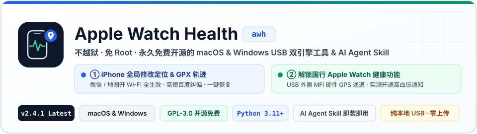
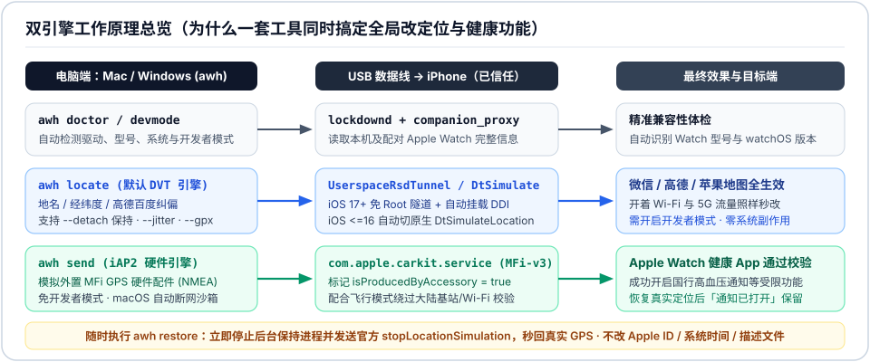
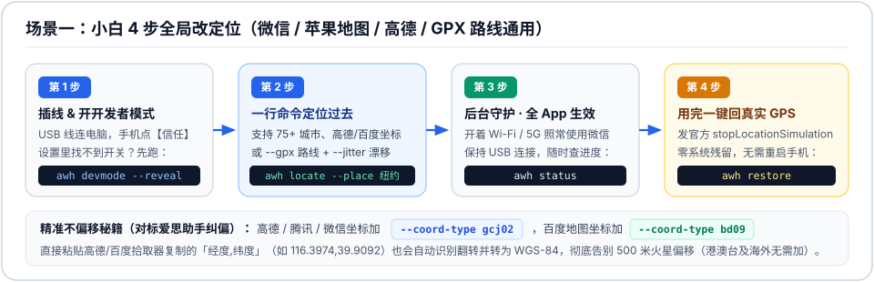
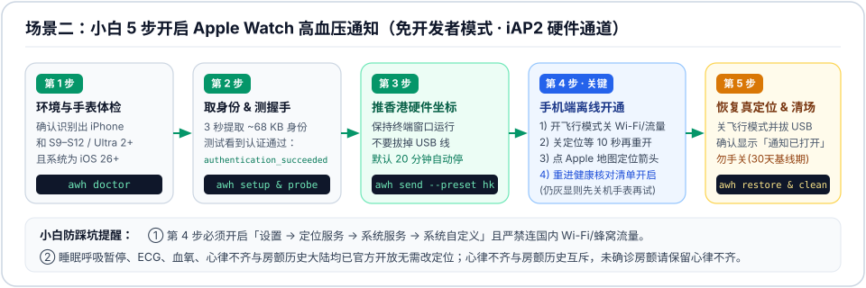

<div align="center">



<br/>

[](https://github.com/1837620622/apple-watch-health/actions/workflows/ci.yml)

[快速了解亮点](#一为什么选择-awh) · [零基础准备工作](#二零基础准备工作纯小白必读) · [全局改定位保姆教程](#三场景一iphone-全局改定位与-gpx-轨迹模拟保姆教程) · [手表高血压通知保姆教程](#四场景二解锁国行-apple-watch-高血压通知保姆教程) · [常见问题 FAQ](#五小白高频问题速查faq) · [命令速查](#六完整命令速查表)

</div>

---

## 一、为什么选择 `awh`？

很多朋友平时只需要两件简单的小事：**① 把 iPhone 临时定位到另一个地方（微信发位置 / 打卡 / 地图调试），用完秒恢复**；**② 给国行 Apple Watch 开启地区受限的健康功能（如高血压通知）**。但市面上要么收费几十上百元、要么闭源不透明、要么改完几秒就跳回原处或偏移五百米。

`apple-watch-health`（简称 `awh`）是一个**完全开源、永久免费、纯本地 USB 运行**的跨平台工具（同时内置 AI Agent Skill）：

| 常见痛点 | 市面收费软件 / 远程代开 | **`apple-watch-health (awh)`** |
| --- | --- | --- |
| **费用与安全** | 收费激活码或远程代开，闭源不透明 | **GPL-3.0 永久免费开源**，纯本地 USB 通信，无云端上传 |
| **系统侵入性** | 改 Apple ID、改系统时间、装描述文件 | **不越狱、免 Root、不改任何系统设置**，用完零副作用一键还原 |
| **高德 / 微信偏移 500 米** | 直接填国内坐标或写反经纬度导致大偏移 | 内置 **GCJ-02 / BD-09 → WGS-84 亚米级纠偏**，自动识别高德/百度「经度,纬度」 |
| **iOS 17+ 定位几秒弹回** | 注入一次就断连，手机很快恢复真实位置 | **后台守护保持 + 自动重连 + 首次自动挂载 DDI 并刷新隧道** |
| **静止死坐标 / 模拟路线** | 只能定死在一个点 | 支持 **`--jitter` 自然微幅漂移** 与 **`--gpx` 路线轨迹回放**（倍速/循环） |
| **健康 App 显示地区不可用** | 普通软件改定位会被 `healthd` 直接拒收 | **内置双引擎**：`send` 走 USB 外置 MFi 硬件通道，实测通过健康地区校验 |
| **新手部署门槛** | 要装 Xcode、折腾 Python 环境 | **零前置开箱即用**：双击/一行命令自动准备隔离环境，`clean --all` 删得干干净净 |
| **AI 助手联动** | 只能全程手动排查 | 原生 **AI Agent Skill**，装进 Claude Code / Codex / Cursor / Antigravity 说人话自动干活 |

### 双引擎工作原理总览

为什么很多工具改了地图却打不开健康功能，或者开了 Wi-Fi 微信定位就不动？因为苹果在 iOS 17–27 上对「普通 App 全局定位」和「健康 App 地区校验」走了两条完全不同的底层通道。本工具按场景内置了**两套独立引擎**：

<p align="center">
  
</p>

**一句话分清该用哪个命令（小白千万别用混）：**
- **只想给微信 / 苹果地图 / 高德等全部 App 改定位（开着 Wi-Fi/5G 正常用）** → 用 **`locate`**（走官方免 Root 开发者通道，需要开启一次开发者模式）。
- **想给国行 Apple Watch 开启高血压通知** → 用 **`send`**（走外置 MFi 硬件 GPS 通道，**不需要**开发者模式，但手机需要开飞行模式离线操作）。

> **真机与跨平台验证说明**：已在 **macOS + iPhone 16 Pro (`iOS 27.2.1`, CH/A) + Apple Watch Series 12 (`watchOS 27.2.1`, CH/B)** 实测跑通 `iAP2` 开通高血压通知与 `DVT` 免 Root 全局改定位及恢复；**macOS 与 Windows** 均已通过完整自动化单测与启动器验证。

---

## 二、零基础准备工作（纯小白必读）

**你完全不需要懂编程，也不需要预装 Python、Git 或 Xcode。** 跟着下面 4 小步准备即可。

### 2.1 硬件准备
1. **一台电脑**：macOS（苹果电脑）或 Windows 10/11 电脑均可。
2. **一根支持数据传输的 USB 数据线**：
   - ⚠️ 很多几十块钱的纯充电线**不能传数据**，插上电脑只会充电、识别不到手机。
   - **判断方法**：插上电脑后，如果 iPhone 弹出「要信任此电脑吗？」或电脑里能看到手机图标，说明这根线支持数据传输。
   - Windows 台式机建议优先插**机箱背后的主板原生 USB 口**，尽量避开供电不稳的前置口或廉价扩展坞。
3. **保持 iPhone 屏幕解锁**（操作过程中尽量亮屏，避免锁屏导致通信中断）。

### 2.2 Windows 电脑必装驱动（macOS 用户直接跳过本小节）

Windows 系统默认没有苹果 USB 通信驱动，只需安装微软官方商店版 **「Apple 设备」**（只需做一次）：

- **方法 A（最简单，点鼠标安装）**：打开 Windows **Microsoft Store（微软应用商店）** → 搜索 **`Apple 设备`**（英文名 `Apple Devices`）→ 点击 **获取 / 安装** → 安装完成后**重启一次电脑**。
- **方法 B（命令行一键安装）**：右键 Windows 开始菜单 → 打开 **终端（管理员）**，复制下面命令回车，装完重启电脑：
  ```powershell
  winget install --id 9NP83LWLPZ9K
  ```

> ⚠️ **两个必看提醒**：
> 1. **不要**同时安装微软商店版「Apple 设备」和苹果官网旧版 exe 安装包「iTunes」，两者驱动会打架！二选一即可（推荐新版「Apple 设备」）。
> 2. 装完重启后插上 iPhone，在「Apple 设备」里点完「信任」识别出手机后，**请把「Apple 设备」窗口关掉**，不要让它一直占着 USB 通道。

### 2.3 下载本工具并打开终端（不会 Git 也能 1 分钟搞定）

#### 第一步：下载并解压
1. 打开本项目的 [Releases 最新版本页面](https://github.com/1837620622/apple-watch-health/releases/latest)。
2. 点击下载 **`apple-watch-health-skill.zip`**。
3. 将压缩包解压到一个简单路径（例如桌面或 `D:\apple-watch-health`）。
4. 双击打开解压后的文件夹，确认里面能直接看到 **`awh.cmd`**（Windows 用）和 **`awh.sh`**（Mac 用）。

*(如果你熟悉 Git，也可以直接 `git clone https://github.com/1837620622/apple-watch-health.git`)*

#### 第二步：在工具文件夹里打开终端窗口
- **Windows 小白打开方式（最稳，推荐用 CMD）**：
  1. 双击打开刚才解压好的 `apple-watch-health` 文件夹（要能看到 `awh.cmd` 这一层）。
  2. 用鼠标单击文件夹窗口**顶部的路径地址栏**（变成蓝底选中状态）。
  3. 直接键盘输入 **`cmd`** 然后按 **回车键（Enter）**，会弹出一个黑色命令行窗口，且已经自动定位到工具目录里了！
- **macOS 小白打开方式**：
  1. 在「访达（Finder）」里找到 `apple-watch-health` 文件夹。
  2. 右键该文件夹 → 点击 **「新建位于文件夹位置的终端窗口」**（如果没有该选项，可先打开「终端」App，输入 `cd ` 加一个空格，再把文件夹拖进终端窗口按回车）。
  3. 首次运行若提示 `Permission denied`，先执行一次：`chmod +x awh.sh`。

#### 第三步：国内网络加速（强烈建议，首次运行更快）
首次运行工具会自动准备隔离的轻量化运行环境（约几十秒，不动你的系统环境）。国内用户先粘贴下面对应你系统的一行命令，即可切换清华镜像极速下载：

- **Windows CMD（黑框窗口）**：
  ```cmd
  set AWH_PYPI_MIRROR=https://pypi.tuna.tsinghua.edu.cn/simple
  ```
- **Windows PowerShell（蓝框窗口）**：
  ```powershell
  $env:AWH_PYPI_MIRROR="https://pypi.tuna.tsinghua.edu.cn/simple"
  ```
- **macOS / Linux 终端**：
  ```bash
  export AWH_PYPI_MIRROR=https://pypi.tuna.tsinghua.edu.cn/simple
  ```

### 2.4 懒人玩法：装给 AI 助手全自动操作（可选）

如果你平时使用 **Claude Code、Codex、Cursor、Antigravity 或 WorkBuddy** 等 AI 助手，甚至不用自己记命令：
1. 把下载的 `apple-watch-health-skill.zip` 解压后，将整个 `apple-watch-health` 文件夹（确保里面直接包含 `SKILL.md`）放到你的 AI 技能目录：
   - Claude Code：`~/.claude/skills/apple-watch-health`
   - Codex：`~/.codex/skills/apple-watch-health`
   - Cursor：`.cursor/skills/apple-watch-health`
   - Antigravity / WorkBuddy：放到全局或项目 `skills/apple-watch-health` 目录
2. 插上 USB 线、解锁 iPhone，新开对话直接用大白话发指令即可：
   - `用 apple-watch-health 帮我体检一下手机和手表，看看能不能开高血压通知`
   - `用 apple-watch-health 把我手机定位改到纽约时代广场，用后台保持模式`
   - `把这个高德坐标 116.3974,39.9092 用 gcj02 纠偏定位过去，加 5 米自然漂移`
   - `用完了，帮我恢复手机真实定位并清理缓存`

### 2.5 必做第 1 步：插上手机跑一次体检（`doctor`）

把 iPhone 用数据线插到电脑，解锁手机屏幕并在弹窗里点 **「信任」** + 输入锁屏密码，然后在终端里输入并回车：

- **Windows（CMD / PowerShell）**：
  ```cmd
  awh.cmd doctor
  ```
- **macOS / Linux**：
  ```bash
  ./awh.sh doctor
  ```

**看到类似下面的输出，就说明电脑、驱动和 USB 连接全部就绪！**

```text
apple-watch-health v2.4.1 | 平台: Windows | Python: 3.12.x
数据缓存目录: C:\Users\你的用户名\AppData\Local\apple-watch-health
[OK] USB 服务: Apple Mobile Device Service (127.0.0.1:27015) 运行中
[MISS] 未配置 MFi 身份文件，请运行: awh setup
[OK] 无残留后台 iAP2 发送进程
[OK] iPhone: 我的 iPhone | iPhone 16 Pro (iPhone17,1) | iOS 27.2.1 | 区域 CH/A | UDID 000081...ABCD | 支持 iOS 26/27 高血压通知
      Watch: Apple Watch | Apple Watch Series 12 (Watch8,3) | watchOS 27.2.1 | 区域 CH/B | 硬件+系统满足高血压通知 & 睡眠呼吸暂停
      开发者模式: 未开启 → `awh devmode --reveal` 后去设置里打开
```

> **小白看图读结果**：
> - 看到 `[OK] USB 服务` 和 `[OK] iPhone: ...` 就代表连接完全正常！
> - `[MISS] 未配置 MFi 身份文件` 只有做 **场景二（开手表健康功能）** 时才需要，做 **场景一（全局改定位）** 完全不用管它！
> - 如果提示未检测到 iPhone，请检查是否用了纯充电线、手机是否解锁点过信任、以及 Windows 是否装好「Apple 设备」驱动并重启。

---

## 三、场景一：iPhone 全局改定位与 GPX 轨迹模拟（保姆教程）

适用场景：想让 **微信发位置 / 朋友圈定位 / 苹果地图 / 高德地图 / 其他所有 App** 定位到地球上任意位置，**全程可以开着 Wi-Fi 和 5G 流量正常上网**，对标爱思助手且完全免费开源。

<p align="center">
  
</p>

*(下方命令均同时列出 Windows `awh.cmd` 与 macOS `./awh.sh`，按你的电脑二选一复制即可)*

### 第 1 步：打开 iPhone「开发者模式」（仅首次需要，iOS 16 及以上）

苹果从 iOS 16 起要求先打开「开发者模式」才允许电脑通过官方调试通道修改定位。**Windows 电脑上如果手机从没连过 Xcode，设置里默认会把「开发者模式」藏起来，看不到开关！**

1. 在终端检查并让 iPhone 显示这个开关：
   ```cmd
   :: Windows
   awh.cmd devmode --reveal
   ```
   ```bash
   # macOS / Linux
   ./awh.sh devmode --reveal
   ```
2. 拿起你的 iPhone，按顺序点击：
   - 打开 **设置** → **隐私与安全性** → 一路划到页面最底部 → 找到并点击 **开发者模式**
   - 把 **开发者模式** 开关点成绿色 → 弹窗点击 **重新启动**
3. 等待手机重启开机，解锁屏幕后会弹出「打开开发者模式？」确认框 → 点击 **打开** 并输入锁屏密码。
4. 手机重新连好后，在终端验证状态（看到「开发者模式已开启」就彻底搞定了，以后不用重复做）：
   ```cmd
   awh.cmd devmode          # macOS 换成 ./awh.sh devmode
   ```

### 第 2 步：一键定位到任意城市或地址

> 💡 **为什么不能改完就把窗口关掉？**
> 苹果 iOS 17+ 规定：模拟定位只在电脑与手机的调试会话存活期间有效，会话一断手机几秒内就会自动回到真实位置。因此本工具提供两种模式：
> - **前台保持（默认）**：终端窗口开着就一直生效；在窗口里按 `Ctrl + C` 立刻恢复真实定位。
> - **后台保持（加 `--detach`）**：工具在后台悄悄守着连接，命令执行完立刻返回，**可以放心关闭当前终端窗口**（但 **USB 数据线不要拔**），用完时再跑 `restore` 恢复真实定位。

**① 直接输城市名或知名地标（内置 75+ 国内外热门城市离线秒解析，其余地名自动联网解析）：**

```cmd
:: Windows：定位到美国纽约（前台保持，按 Ctrl+C 恢复）
awh.cmd locate --place "纽约"

:: Windows：定位到日本东京（后台保持，命令立刻返回，可关闭窗口）
awh.cmd locate --place "东京" --detach

:: Windows：定时保持 10 分钟（600 秒）后自动恢复真实定位
awh.cmd locate --place "Apple Park" --hold 600
```

```bash
# macOS / Linux 对应命令：
./awh.sh locate --place "纽约"
./awh.sh locate --place "东京" --detach
./awh.sh locate --place "Apple Park" --hold 600
```

**② 首次运行小提醒**：如果这台 iPhone 从没在电脑上挂过开发者镜像（Developer Disk Image / DDI），第一次执行 `locate` 时工具会自动联网下载并挂载对应版本 DDI、再自动重连刷新通道，**首次可能需要等待 15–40 秒**，期间请保持手机亮屏解锁且电脑联网；成功后之后每次切换地点都是秒生效！

**③ 验证是否成功**：终端打印 `[OK] 已将 ... 全局定位至 ...` 后，直接打开手机的 **苹果地图** 或 **微信 → 聊天 → `+` → 位置 → 发送位置**，就能看到蓝点已经瞬移到目标地点！

### 第 3 步：精准定位到国内某栋楼 / 小区 / 门店？（高德 & 百度零偏移教程）

很多新手从高德或百度地图找了个坐标直接填进去，结果手机上差出 **300–600 米**，这是因为国内地图使用的是加密坐标系（高德/腾讯/微信用 **GCJ-02**，百度用 **BD-09**），而 iPhone 底层 GPS 只认国际标准 **WGS-84**。

按下面 3 步，精度直接拉到 **误差小于 1 厘米**：

1. 电脑浏览器打开高德坐标拾取器（搜「高德坐标拾取器」即可）或百度坐标拾取器。
2. 在地图上搜索并点一下你要去的精确地点，右上角会显示一串数字，例如天安门的高德坐标：`116.397428,39.90923`（注意高德/百度默认是 **经度在前、纬度在后**）。
3. **直接把那串数字原封不动复制进 `--place`，并加上对应的 `--coord-type`**（本工具会自动识别经纬度顺序并精准纠偏！）：

```cmd
:: 高德 / 腾讯 / 微信坐标（自动识别「经度,纬度」+ GCJ-02 精准纠偏）
awh.cmd locate --place "116.397428,39.90923" --coord-type gcj02 --detach

:: 百度地图坐标（自动识别「经度,纬度」+ BD-09 精准纠偏）
awh.cmd locate --place "116.403963,39.915119" --coord-type bd09 --detach

:: 也支持显式传 --lat（纬度）与 --lon（经度）
awh.cmd locate --lat 39.90923 --lon 116.397428 --coord-type gcj02 --detach
```
*(macOS 把 `awh.cmd` 换成 `./awh.sh`；香港、澳门、台湾与国外地点默认就是标准 `wgs84`，**不需要**加 `--coord-type`。)*

### 第 4 步：进阶玩法 — 自然微幅漂移 & GPX 路线轨迹模拟

- **自然微幅 GPS 漂移（`--jitter`）**：真实手机在户外定位每秒会有几米的自然波动。加上 `--jitter 5` 后，每次刷新会在目标点 ±5 米半径内轻微自然移动，更像真实信号：
  ```cmd
  awh.cmd locate --place "上海" --jitter 5 --detach
  ```

- **GPX 路线轨迹回放（`--gpx`，兼容爱思助手 / 户外工具导出的标准 GPX 1.0 & 1.1）**：
  1. 在工具目录新建一个文本文件并命名为 `demo.gpx`，粘贴下面内容（或直接使用爱思助手导出的 `.gpx` 文件）：
     ```xml
     <?xml version="1.0" encoding="UTF-8"?>
     <gpx version="1.1">
       <trk><trkseg>
         <trkpt lat="39.9087" lon="116.3975"><time>2026-11-27T08:00:00Z</time></trkpt>
         <trkpt lat="39.9095" lon="116.3985"><time>2026-11-27T08:00:05Z</time></trkpt>
         <trkpt lat="39.9103" lon="116.3995"><time>2026-11-27T08:00:10Z</time></trkpt>
       </trkseg></trk>
     </gpx>
     ```
  2. 执行回放（支持 `--speed` 调倍速、`--loop` 循环播放、`--coord-type gcj02` 整条路线纠偏、`--jitter 3` 叠加微漂移、`--detach` 后台播放）：
     ```cmd
     awh.cmd locate --gpx demo.gpx --speed 1.5 --loop --detach
     ```

### 第 5 步：随时查看状态、切换地点与一键恢复真实 GPS

- **查看当前改到哪了 / GPX 跑了几个点**：
  ```cmd
  awh.cmd status           # macOS 用 ./awh.sh status
  ```
- **想换一个新地点**：直接再执行一次 `locate` 即可，工具会自动先停掉旧的保持进程再切到新地点。
- **用完恢复真实定位（零副作用，无需重启手机）**：
  ```cmd
  awh.cmd restore          # macOS 用 ./awh.sh restore
  ```
  执行后会停止后台保持进程并向手机发送官方 `stopLocationSimulation` 指令。随后即可拔掉 USB 数据线，打开苹果地图点一下定位箭头，蓝点就会回到你的真实位置。（如果极少数情况地图仍有缓存未刷新，重启一次 iPhone 100% 恢复出厂真实定位。）

---

## 四、场景二：解锁国行 Apple Watch 高血压通知（保姆教程）

### 4.1 开始前先查表：2026-11 中国大陆功能现状（别白折腾）

截至 **2026 年 11 月**，国行 Apple Watch 绝大多数健康功能已经官方直接开放，**只有仍在审批中的「高血压通知」需要用本工具临时切换地区**：

| 功能 | 中国大陆原生状态 | 需要用本工具吗 | 机型与人群门槛 |
| --- | --- | --- | --- |
| **高血压通知** | 未开放（监管审批中） | **✅ 需要** | Watch **S9 / S10 / S11 / S12、Ultra 2 / 3 / 4**（**SE 全系不支持**）；iPhone 11+；iOS 26+ / watchOS 26+；年满 22 岁、未怀孕、未确诊高血压 |
| **睡眠呼吸暂停提示** | **2026-10-14 已官方开放** | 旧系统才需要 | 新系统直接在健康 App 开；S9+ / Ultra 2+ / SE 3；年满 18 岁未确诊 |
| **心电图 (ECG) / 血氧 / 心律不齐 / 房颤历史** | 已全部官方开放 | ❌ 不需要 | 正常联网直接在健康 App / Watch App 开 |
| **准备指数 / 生命体征 / 睡眠评分** | S12 原生全支持 | ❌ 不需要 | watchOS 27 自带 |
| **卫星联络 / 国行快充 / FaceTime Audio** | 硬件或系统级限制 | ❌ **改定位无效** | 非地区定位开关，无法通过定位开启 |

完整条件可查看 [references/feature-matrix.md](references/feature-matrix.md)，或在终端运行 `awh.cmd features`（Mac 为 `./awh.sh features`）。

<p align="center">
  
</p>

### 4.2 电脑端 4 步操作（免开发者模式）

插上 USB 数据线、解锁 iPhone，依次执行以下 4 条命令（Windows 用 `awh.cmd`，macOS 用 `./awh.sh`）：

**Step 1：体检并确认手表机型满足要求**
```cmd
awh.cmd doctor
```
确认输出里识别出了你的 iPhone（iOS 26+）和 Apple Watch（S9–S12 / Ultra 2–4，watchOS 26+）。

**Step 2：3 秒极速准备本地 MFi 实验身份（仅 ~68 KB）**
```cmd
awh.cmd setup
```
- 本仓库**不包含任何密钥或 APK**，该命令按固定 SHA-256 校验码从公开研究包中仅拉取 ~68 KB 的身份文件存入你的系统私人缓存目录，绝不污染代码目录。
- **如果遇到 GitHub 限流报错（HTTP 403 / 429）**：可先手动下载 [DiPlay-0.2.7.apk](https://github.com/shihabal3amri/DiPlay/releases/download/v0.2.7/DiPlay-0.2.7.apk)，然后离线提取：
  ```cmd
  awh.cmd setup --apk "C:\Users\你的用户名\Downloads\DiPlay-0.2.7.apk"
  ```

**Step 3：握手测试（先验通道，不发坐标）**
```cmd
awh.cmd probe --duration 15
```
**通过标准**：等待几秒，屏幕上依次出现下面 4 个事件（且退出无报错）即代表硬件认证彻底通了：
1. `device_connected`（USB 连上了）
2. `link_ready`（iAP2 链路层握手成功）
3. `identification_accepted`（配件身份被 iPhone 接受）
4. `authentication_succeeded`（MFi-v3 认证通过 —— 最核心节点！）

*(若出现 `0xAA04`，说明该共享实验证书被当前系统拒绝，详见 [references/troubleshooting.md](references/troubleshooting.md)。)*

**Step 4：开始推送香港中环硬件 GPS 坐标**
```cmd
awh.cmd send --preset hk
```
- 命令会持续运行（默认 20 分钟自动停止，USB 抖动会自动重连）。
- **现在千万不要关掉这个终端窗口，也不要拔掉 USB 线！** 直接拿起你的 iPhone 做下面 4.3 节的手机端操作。

### 4.3 手机与手表端 5 步必做操作（缺一不可！）

90% 没成功的案例，都是因为只跑了电脑命令、漏掉了下面手机端的某一步。请保持 **USB 线插着** 且 `send --preset hk` 运行中，严格按顺序操作：

1. **开启飞行模式 + 关闭 Wi-Fi + 关闭蜂窝流量（保留蓝牙开）**
   - 下拉控制中心：点亮 **飞行模式**，并**手动把 Wi-Fi 图标和蜂窝数据都彻底关掉**（如果 Wi-Fi 还是白色的未彻底关闭，进「设置 → Wi-Fi」把它关成灰色）。
   - **为什么必做？** 国内基站信号和国内路由器的 Wi-Fi 国家码会立刻把手机地区强行拉回中国大陆（`CN`）导致被拦截！iPhone 内置离线国界数据，完全离线照样能精准认出香港（`HK`）；**蓝牙保持开启**以便连接手表。
2. **检查两个容易漏掉的定位开关**
   - 打开 `设置 → 隐私与安全性 → 定位服务 → 划到最底点「系统服务」 → 系统自定义`：**必须打开（绿色）**。
   - 回到 `设置 → 隐私与安全性 → 定位服务 → 地图`：设为 **「使用 App 期间」** 且打开 **「精确位置」**。
3. **重置手机定位缓存（最关键的一步！）**
   - 进 `设置 → 隐私与安全性 → 定位服务` → 把总开关 **关闭** → **心里默数满 10 秒** → 再重新 **打开**。
   - 打开 iPhone 自带的 **Apple 地图**，点一下右上角的 **定位箭头**（因为开了飞行模式，底图一片空白是完全正常的，目的是触发手机向电脑索取香港坐标；此时电脑窗口通常会出现 `location_requested` 和 `location_link_acknowledged`）。
4. **进入健康 App 开通高血压通知**
   - 从屏幕底部上划，**把「健康」App 卡片彻底划掉退出后台**，再重新点开 **健康 App**。
   - 点右上角 **头像** → 点 **健康核对清单** → 找到 **高血压通知** → 点击 **设置**，由你本人如实填写年龄与健康问卷完成开通。
   - 开通完成后，进入「高血压通知」详情页，确认看到绿色的 **「通知已打开」**！
5. **如果健康核对清单里还是灰显 / 提示地区不可用怎么办？**
   - **大招（处理手表侧缓存）**：有时 iPhone 已经是 `HK`，但 Apple Watch 自己连着家里 Wi-Fi 缓存了 `CN`。此时保持手机飞行模式和电脑 `send` 运行，**直接把 Apple Watch 关机**（或者关掉手表的 Wi-Fi），然后划掉并重开 iPhone「健康」App 再试！如果设置中途系统提示需要连接手表，再把手表开机（保持手表 Wi-Fi 关闭，只走蓝牙连手机）。
   - **换美国坐标重试**：按 `Ctrl+C` 停掉香港坐标，改跑 `awh.cmd send --preset us-sf` 重复第 3–4 步。
   - **实时看底层日志告别盲猜**：另开一个终端窗口运行 `awh.cmd monitor --duration 120`，可以实时看到脱敏后的 `GPRMC NMEA Screening` 和 `countryCode = HK` 判定过程。

### 4.4 必读提醒：关于两个名字极像的「房颤」功能

健康 App 里有两个名字非常像的功能（两项大陆都已官方开放，恢复联网直接能开），苹果强制**二选一互斥**：
- **移动脉率房颤提示软件（心律不齐通知）**：给 **没确诊过房颤的普通人** 日常预警用。
- **移动脉率房颤迹象记录软件（房颤历史）**：只给 **医生已确诊房颤的患者** 统计每周房颤占比用。

> **一句话记住**：开了其中一个，另一个就一定不能开。普通人保留「心律不齐通知」即可，千万别误开「房颤历史」（开了反而会把心律不齐通知关掉）。

### 4.5 开通后的安全恢复与彻底清场

1. 回到终端窗口按 `Ctrl + C` 停止推送，或新开窗口运行一键恢复：
   ```cmd
   awh.cmd restore          # macOS 用 ./awh.sh restore
   ```
2. **关闭 iPhone 飞行模式**（恢复 Wi-Fi 与蜂窝流量），**拔掉 USB 数据线**。
3. 打开 **Apple 地图**确认回到真实位置（如果蓝点还停在香港，关闭「定位服务」等 10 秒再打开即可秒回真实位置）。
4. 再次打开 **健康 App → 高血压通知详情页**，确认 **「通知已打开」** 依然稳稳保留。
   - ⚠️ **重要**：高血压通知开通后的前 **30 天是基线采集期**，期间不会发通知属于完全正常现象，**请勿手动关闭开关**（手动关闭后再次开启会重新校验当下地区）。
5. 如果以后不打算再折腾，想把电脑上所有临时文件删得一干二净：
   ```cmd
   awh.cmd clean            # 只清临时日志和缓存，保留 MFi 身份方便以后复测
   awh.cmd clean --all      # 彻底删光本地身份、缓存目录与 .venv 虚拟环境，不留痕迹
   ```

---

## 五、小白高频问题速查（FAQ）

| 遇到的现象 / 报错 | 原因是什么 | 一句话怎么解决 |
| --- | --- | --- |
| Windows 首次运行下载特别慢或超时 | 默认直连国外 PyPI 源 | 运行前先执行清华镜像环境变量（见 [2.3 节第三步](#第三步国内网络加速强烈建议首次运行更快)） |
| `doctor` 提示未检测到 USB 服务 (`127.0.0.1:27015`) | Windows 没装驱动或服务没起 | 微软商店装「Apple 设备」并**重启电脑**；别同时装旧版 exe iTunes |
| `doctor` 提示未检测到 USB iPhone | 用了纯充电线、未解锁或驱动窗口占线 | 换能传数据的原装/MFi 线 → 解锁点【信任】→ 关掉 Windows「Apple 设备」窗口 |
| iPhone 设置里找不到「开发者模式」开关 | 从没连过 Xcode 的 iPhone 默认隐藏该项 | 终端执行 `awh.cmd devmode --reveal`（Mac 用 `./awh.sh devmode --reveal`）后去设置最底部打开 |
| `locate` 首次等了十几秒或报 `InvalidServiceError` | 手机尚未挂载 Developer Disk Image (DDI) | 保持手机解锁、已开开发者模式且电脑联网，工具会自动下载挂载并刷新隧道重试 |
| 改完国内定位发现微信/高德偏了 500 米 | 填了高德/百度加密坐标却没开启纠偏 | 高德/腾讯/微信坐标加 `--coord-type gcj02`，百度加 `--coord-type bd09` |
| 粘贴高德坐标提示纬度超出 `-90..90` | 高德坐标是「经度,纬度」顺序 | `v2.4.0+` 直接传 `--place "116.3974,39.9092" --coord-type gcj02` 会自动翻转识别 |
| `awh setup` 提示 GitHub API 403 / 429 | 当前网络出口触发 GitHub 匿名频控 | 手动下载 DiPlay v0.2.7 APK 后用 `setup --apk <文件路径>` 离线提取 |
| 开高血压通知时地图蓝点不动或健康仍灰显 | 漏开飞行模式、未重置定位缓存或手表缓存了大陆 | 彻底关 Wi-Fi/流量 → 关定位等 10 秒重开 → 点地图定位箭头 → 仍不行先把 Apple Watch 关机再重开健康 App |
| 用完后手机地图还停在虚拟位置 | 缓存尚未刷新或后台进程未停 | 运行 `awh.cmd restore --force-dvt`，关闭飞行模式并开关一次定位服务；终极兜底：重启 iPhone 100% 恢复 |

更多底层机制与深度排障请阅读 [references/troubleshooting.md](references/troubleshooting.md)。

---

## 六、完整命令速查表

*(Windows 把 `awh` 写成 `awh.cmd`，macOS/Linux 写成 `./awh.sh`)*

| 命令 | 常用示例与作用 |
| --- | --- |
| `doctor` | `awh doctor` — 全面体检：系统、USB 驱动、MFi 身份、后台进程、自动识别 iPhone & Apple Watch |
| `status` | `awh status` — 秒看当前 DVT 定位保持目标、GPX 轨迹进度、iAP2 发送器与 MFi 状态 |
| `devices` | `awh devices --all` — 列出已连接设备与配对手表（`--full-udid` 显示完整 UDID） |
| `devmode` | `awh devmode --reveal` — 查看/显示/开启 iPhone 开发者模式（`--enable` 仅限无锁屏密码） |
| `locate` | `awh locate --place "纽约" --detach` — 全局改定位与 GPX 轨迹模拟（支持 `--lat/--lon`、`--coord-type wgs84\|gcj02\|bd09`、`--jitter`、`--gpx`、`--speed`、`--loop`、`--hold`、`--engine iap2`） |
| `restore` | `awh restore` — 停止所有模拟进程并发送官方 `stopLocationSimulation`，零副作用秒回真实 GPS |
| `setup` | `awh setup` — 3 秒分段提取本地 MFi 实验身份（支持 `--full-apk`、`--apk`、`--cert/--key`、`--force`） |
| `probe` | `awh probe --duration 15` — 仅测试 USB iAP2 识别与 MFi-v3 握手，不发送坐标 |
| `send` | `awh send --preset hk` — 推送硬件级 MFi GPS 坐标（专用于开通 Apple Watch 健康功能） |
| `monitor` | `awh monitor --duration 120` — 实时监听脱敏后的 iPhone 定位筛查（`GPRMC`）与健康地区状态日志 |
| `features` | `awh features` — 查看 2026-11 中国大陆 Apple Watch 功能支持矩阵 |
| `presets` | `awh presets` — 查看内置验证通过的坐标预设（`hk`, `hk-tst`, `mo`, `us-sf`, `us-ny`, `jp`, `sg`, `tw`） |
| `stop` | `awh stop` — 优雅停止后台 iAP2 发送进程并清理子进程与锁 |
| `clean` | `awh clean --all` — 清理临时缓存；加 `--all` 彻底删光本地身份与 `.venv` |

---

## 七、目录结构与法律免责声明

```text
apple-watch-health/
├── assets/             # 本地高清 SVG 头图、架构图与小白操作流程图（零外链永不裂图）
├── SKILL.md            # AI Agent Skill 规范入口（Claude Code / Codex / Cursor / Antigravity）
├── README.md           # 本小白保姆级完整文档
├── CHANGELOG.md        # 版本更新日志
├── LICENSE             # GNU GPL-3.0-only 开源协议
├── pyproject.toml      # 跨平台依赖定义与校验配置
├── awh.sh / awh.cmd    # macOS/Linux & Windows 零配置自动引导启动器
├── references/         # 2026-11 功能矩阵、底层排障手册、法律与安全边界
├── src/                # 核心实现（DVT / DtSimulateLocation / iAP2 / 坐标纠偏 / GPX / 断网沙箱）
└── tests/              # 自动化单元测试套件（42 项用例，macOS & Windows CI 覆盖）
```

### 法律与免责声明

1. **完全开源免费，零费用**：本项目以 [GNU GPL-3.0-only](LICENSE) 协议开源，**永久免费，不收任何费用**，没有付费版、激活码或商业代开服务。任何第三方渠道的收费倒卖均与作者无关，谨防受骗。
2. **使用即默认同意并自担全部责任**：下载、安装、运行或参考本项目的任何代码与文档，即默认你已阅读并同意 [references/legal-and-security.md](references/legal-and-security.md) 的全部条款，**自行承担由此产生的一切法律、监管合规、设备保修、账号及健康风险**，作者与贡献者不承担任何直接或间接责任。
3. **非医疗器械**：Apple Watch 高血压通知、睡眠呼吸暂停提示等仅作消费级健康趋势参考，**测不出具体血压数值，不能替代袖带血压计或专业医生诊断**；身体不适请立刻就医。
4. **零内置密钥与研究边界**：本仓库**不包含、不分发任何 MFi 证书、私钥或 APK 文件**，仅限设备所有人在本人自有设备上做技术研究与兼容性测试，严禁用于商业代开或批量操作。本项目与 Apple Inc.、DiPlay、Carlinkit 等无任何关联。

<details>
<summary>致谢与上游参考</summary>

- 协议与实现参考：[aur3l14no/accessory-location](https://github.com/aur3l14no/accessory-location)、[xpqball/iap2-location-bridge-windows](https://github.com/xpqball/iap2-location-bridge-windows)、[youcci/playport](https://github.com/youcci/playport)、[flute/apple-watch-hypertension-skill](https://github.com/flute/apple-watch-hypertension-skill)、[doronz88/pymobiledevice3](https://github.com/doronz88/pymobiledevice3)
- 第三方实验凭据来源披露：[shihabal3amri/DiPlay THIRD_PARTY_NOTICES](https://github.com/shihabal3amri/DiPlay/blob/main/docs/THIRD_PARTY_NOTICES.md#experimental-authentication-data)

</details>
